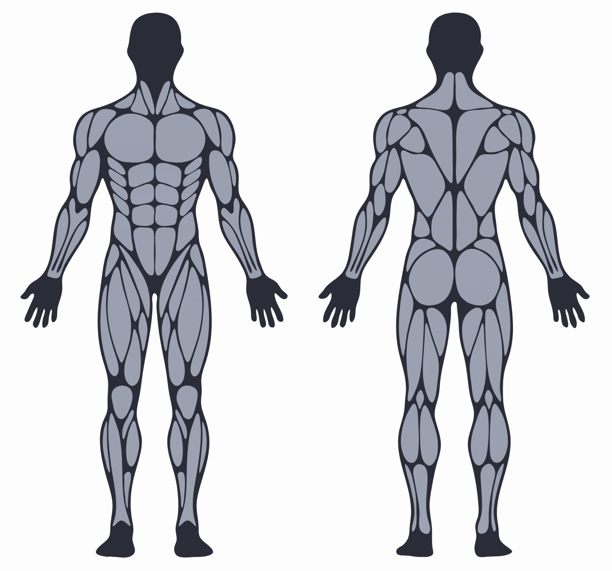
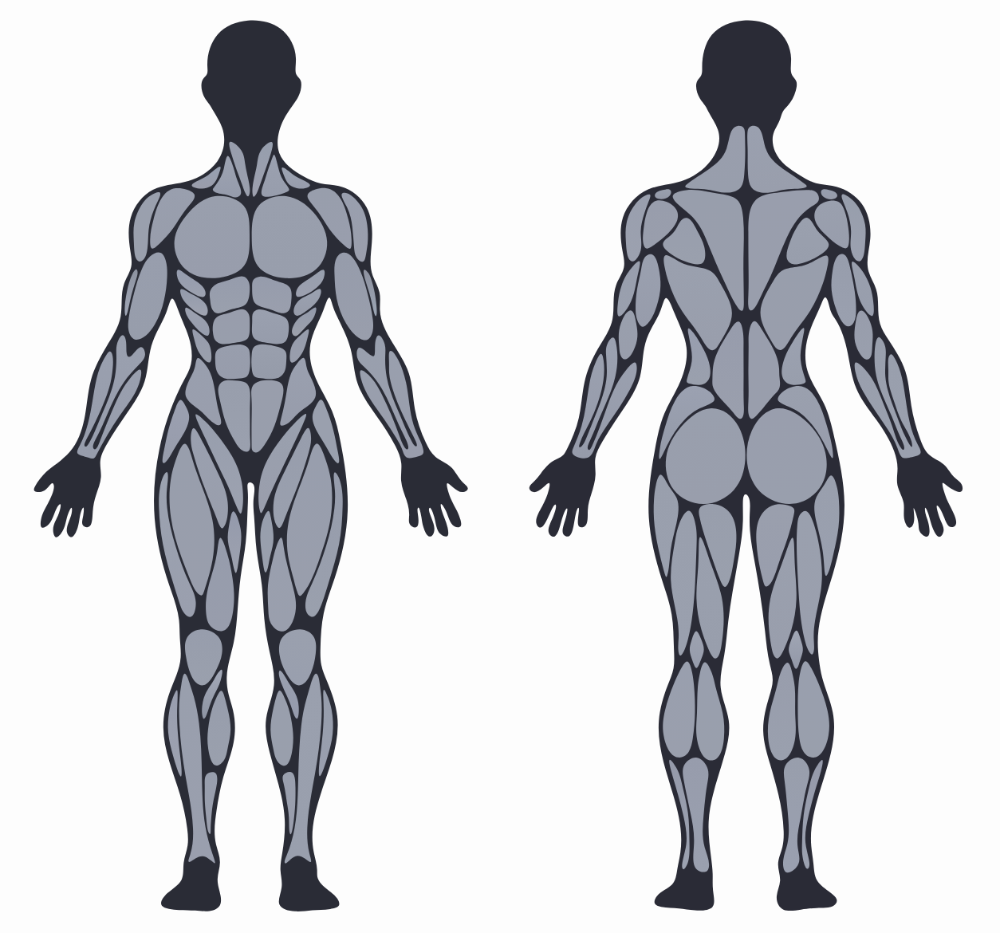

# Open Muscle Map

[](https://github.com/PerspicaciousGuy/Open-Muscle-Map/actions/workflows/verify.yml) [](LICENSE)

A free, tappable front-and-rear human muscle map as vector artwork: **male and female SVGs** with named regions, stable IDs, left/right metadata, and ready-made controllers for the browser, React Native and WebViews.

| Male | Female |
|---|---|
|  |  |

Use it for workout trackers, anatomy explainers, physio tools, or anything that needs "tap a muscle, get its name". The data is plain SVG paths plus JSON, so it can be rendered on any platform.

> **Status: v1.1, schematic.** The shapes are a stylized fitness-app diagram, not a dissection-grade atlas. Names were reviewed against anatomy references, but some regions are group labels or are uncertain. See [Accuracy](#accuracy-and-limitations) before using it for anything medical or educational.

## What you get

- **110 named panels per map**: 100 selectable muscle panels covering **31 muscles or muscle groups**, plus 10 non-muscle panels (kneecap, patellar tendon region, back of knee, IT band, Achilles tendon) that stay visible but are not tappable.
- **Front and rear views** for both sexes. Anatomical left and right refer to the person, not the screen.
- **Deltoid in three parts** (anterior, lateral, posterior) and the triceps, hamstring and calf heads drawn as separate panels.
- **Transparent background**: the artwork has no backdrop, so it sits on any surface. Use a neutral light or dark one: the silhouette and muscle tones were drawn for near-white and near-black. To add a colour, set `[data-background] { fill: ... }` in CSS or `backgroundColor` in React Native.
- **Heatmap**: `setColors({ lateral_deltoid: 0.8 })` colours muscles by value (or any CSS colour); the React Native component takes a `colors` prop.
- **Selection logic**: single, multiple, or both-sides-together, with keyboard access (Enter/Space) and a name search in the demo.

## Try it

**Live demo: https://perspicaciousguy.github.io/Open-Muscle-Map/**

Integrating with an AI coding agent (Claude Code, Codex, Cursor and others)? Point it at [`AGENTS.md`](AGENTS.md).

The site has the demo, copy-paste guides for JavaScript, React, React Native, SwiftUI and Android, the API, and a table of muscle IDs. To run it locally: `node scripts/build-site.mjs`, then serve `_site/` (for example `python3 -m http.server -d _site`).

## Repository layout

| Path | What it is |
|---|---|
| [`muscle-map/`](muscle-map) | The package: SVGs, JSON data, controller (`muscle-map.js`), TypeScript types, React Native component, WebView pages. Package-level docs are in [`muscle-map/README.md`](muscle-map/README.md). |
| [`docs/VERIFICATION.md`](docs/VERIFICATION.md) | Per-muscle review of how well each name fits the drawing. |
| [`docs/SOURCES.md`](docs/SOURCES.md) | Anatomy and integration references. |
| [`docs/CHANGELOG.md`](docs/CHANGELOG.md) | Name corrections made after review. |

Key files inside `muscle-map/`:

- `male-muscle-map.svg`, `female-muscle-map.svg`: the artwork with semantic `data-*` attributes, titles and focus targets.
- `male-map-data.json`, `female-map-data.json`: the same paths, transforms and gradients in a renderer-friendly format.
- `regions.json`: every panel's name, ID, side, view, selection key, centre and bounds.
- `muscles.json`: the 36-entry catalog (31 selectable muscles/groups plus non-muscle structures) with names, anatomical terms and notes.

## Use it

### Browser (inline SVG)

Load the SVG as inline markup (an `` shows the picture but does not expose the paths), then bind the controller:

```html
<div id="body-map"></div>
<script src="./muscle-map/muscle-map.js"></script>
<script>
(async () => {
  const response = await fetch('./muscle-map/male-muscle-map.svg');
  document.querySelector('#body-map').innerHTML = await response.text();
  const svg = document.querySelector('#body-map svg');
  const map = MuscleMap.createMuscleMap(svg, {
    multiple: true,
    onSelect: (region) => console.log(region.muscleId, region.side, region.view),
    onChange: (selected) => console.log(selected)
  });
  map.setSelected(['right:lateral_deltoid']);
})();
</script>
```

### React Native

Install `react-native-svg`, copy `MuscleMap.tsx`, `muscle-map.d.ts` and both `*-map-data.json` files together, and enable `resolveJsonModule`:

```tsx
import MuscleMap from './muscle-map/MuscleMap';

<MuscleMap sex="male" view="both" width={360} multiple
  onMusclePress={(region) => console.log(region.muscleId)} />
```

The component has not been run on a device yet; please report issues.

### WebView (iOS, Android, React Native)

`muscle-map/male-webview.html` and `female-webview.html` run without external resources and post `{ type: 'musclemap:select', payload }` through `window.ReactNativeWebView.postMessage` or `window.webkit.messageHandlers.muscleMap`.

### Other platforms (SwiftUI, Jetpack Compose, Flutter)

There is no native package yet. `*-map-data.json` lists every shape with its `transform`, SVG path `d` strings, gradient fill and `region` metadata, so any renderer that can parse SVG path data can draw and hit-test it. Contributions of reference loaders are welcome.

## IDs and selection

Example region ID: `male-front-right-lateral_deltoid-01`.

- `regionId`: unique artwork panel, prefixed with sex. `regionKey`: the same without the sex prefix, identical across both maps.
- `muscleId`: shared name such as `lateral_deltoid` or `rectus_abdominis`. The same `muscleId` is used in front/rear and male/female.
- `selectionKey`: side plus muscle, for example `right:lateral_deltoid`. With `bilateral`, it becomes `both:lateral_deltoid`.
- `subregion`: optional drawn portion such as `upper`, `lower`, `upper_lateral`, `medial_head`.
- `kind`: `muscle`, `muscle_group`, `joint`, `fascia` or `tendon`.

**Anatomical right is screen-left in the front view and screen-right in the rear view.** The side metadata already handles this; do not mirror the assets without remapping it.

## Accuracy and limitations

- The artwork is a **schematic fitness diagram**. Outlines do not follow exact surface anatomy, and every panel is marked `mappingPrecision: schematic_region`.
- Where the drawing cannot separate muscles, regions carry **group labels**: posterior rotator cuff, forearm flexors/extensors, hip adductors, medial hamstrings, erector spinae and the peroneal group. Deep muscles that the drawing does not show are not represented.
- The male map was reviewed panel by panel against anatomy references: 14 of 36 catalog entries are source-backed, 5 partly verified, 16 likely and 1 uncertain (brachialis). Details and reasons are in [`docs/VERIFICATION.md`](docs/VERIFICATION.md).
- The **female map has the same panel keys, muscle IDs and selectability as the male map** (checked automatically). Its drawing was compared visually for the uncertain muscles, but the anatomy sources were not checked against it separately.
- Not medical or training advice.

## Provenance and license

Open Muscle Map is created and maintained by [PerspicaciousGuy](https://github.com/PerspicaciousGuy). It started from an AI-generated reference image, which was traced into clean vector paths, smoothed, split into individually named panels, given IDs and tap metadata, and then checked muscle by muscle against anatomy references (see [`docs/VERIFICATION.md`](docs/VERIFICATION.md)) and corrected where the names did not fit.

Because the starting image was AI-generated, there is no guarantee that the artwork is free of third-party material, so it is provided as is, without warranty.

Released under the [MIT License](LICENSE). Reuse is allowed, including commercially, if you keep the copyright notice.

## Contributing

See [`CONTRIBUTING.md`](CONTRIBUTING.md). Issues and pull requests are welcome, especially:

- **Anatomy corrections**, with a source (a textbook or reference page), against [`docs/VERIFICATION.md`](docs/VERIFICATION.md).
- Reference loaders for SwiftUI, Jetpack Compose or Flutter.
- Review of the female artwork against anatomy sources.

## Roadmap

- Review the female artwork region by region against anatomy sources.
- Separate muscles currently drawn as groups, if the artwork is redrawn.
- Native iOS and Android examples.
